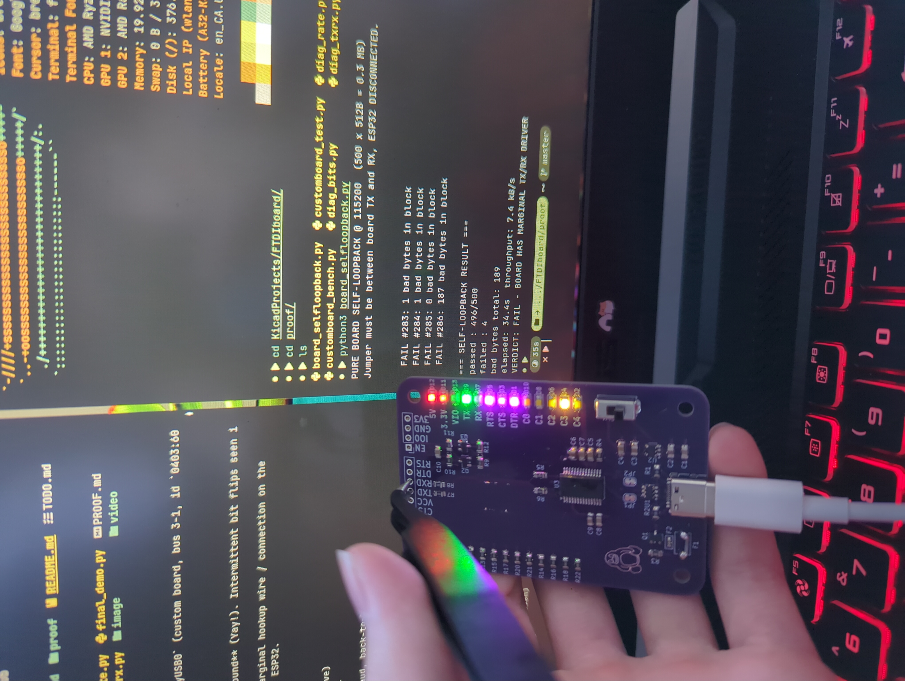
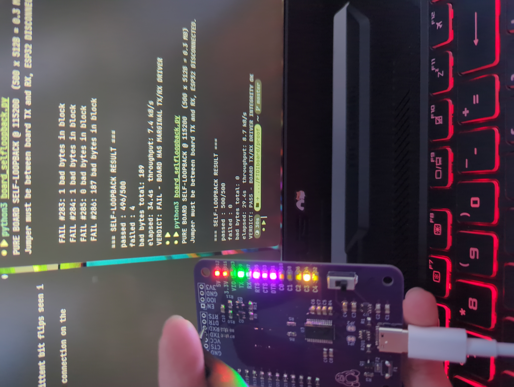

# September 21: v1.1 boards arrived, built

## What I did

- v1.1 pcbs arrived (redesign from september 1 - uln2003s gone, second fuse added, all the fat trimmed)
- assembled the board
- skipped the fuse again, bridged it with tweezers (same as v1.0)
- powered it up

## Why

- wanted to prove the redesign is actually better, not just prettier in the schematic
- leds didnt work on v1

## Screenshots

[bridging the fuse](proof/V1-1/video/VID_20260921_184839.mp4)

once the bridge was in, all the leds lit up and stayed lit - nicest possible first reaction from a board.

**Total time spent: 3 hours**

---

# September 21: v1.1 testing

## What I did

- reran the whole proof kit on the v1.1 board - self-loopback, paced esp32 traffic, sustained-load stress
- confirmed the two v1.0 bugbear fixes hold: auto reset stage no longer latches, vccio rail follows the switch
- recorded the test script running

## Why

- v1.0 testing taught me 512-byte back-to-back blocks are the killer for bit flips through the esp32, so i wouldnt trust v1.1 blind
- wanted on-camera proof instead of "trust me it passed"

## Screenshots

[test script running](proof/V1-1/video/VID_20260921_190001.mp4)

board sat there doing the full self loopback pass clean. the fixes from the redesign actually fixed things and not just the drawing. v1.1 works.

**Total time spent: 3 hours**