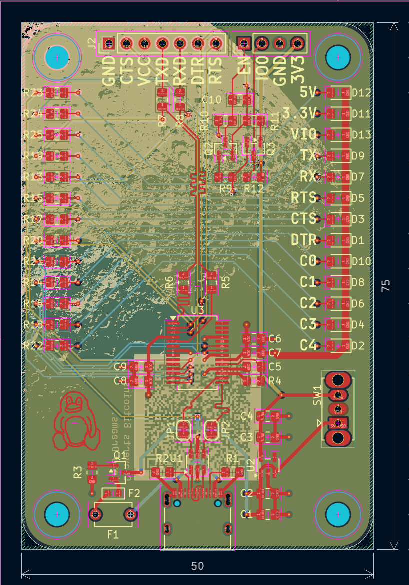
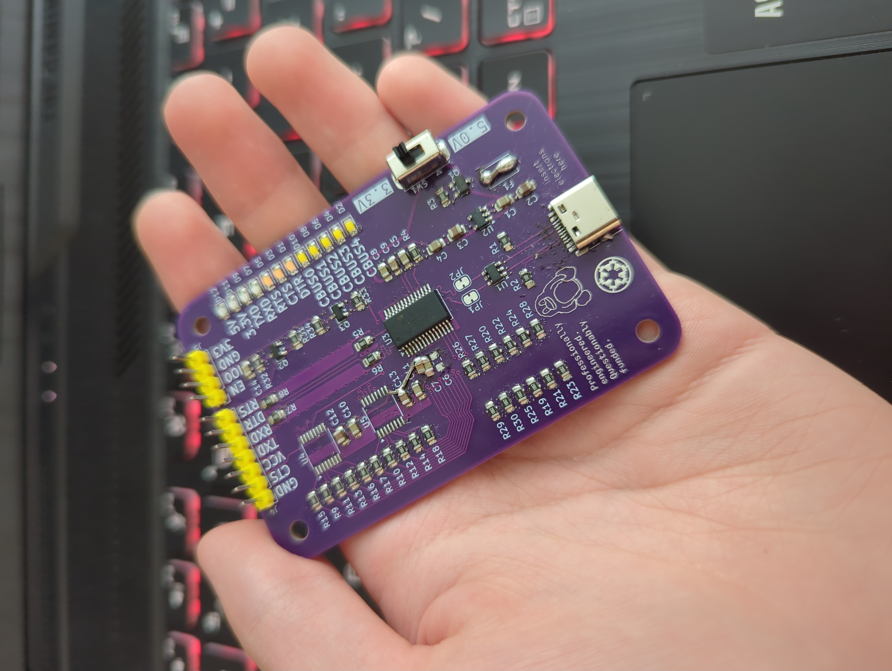
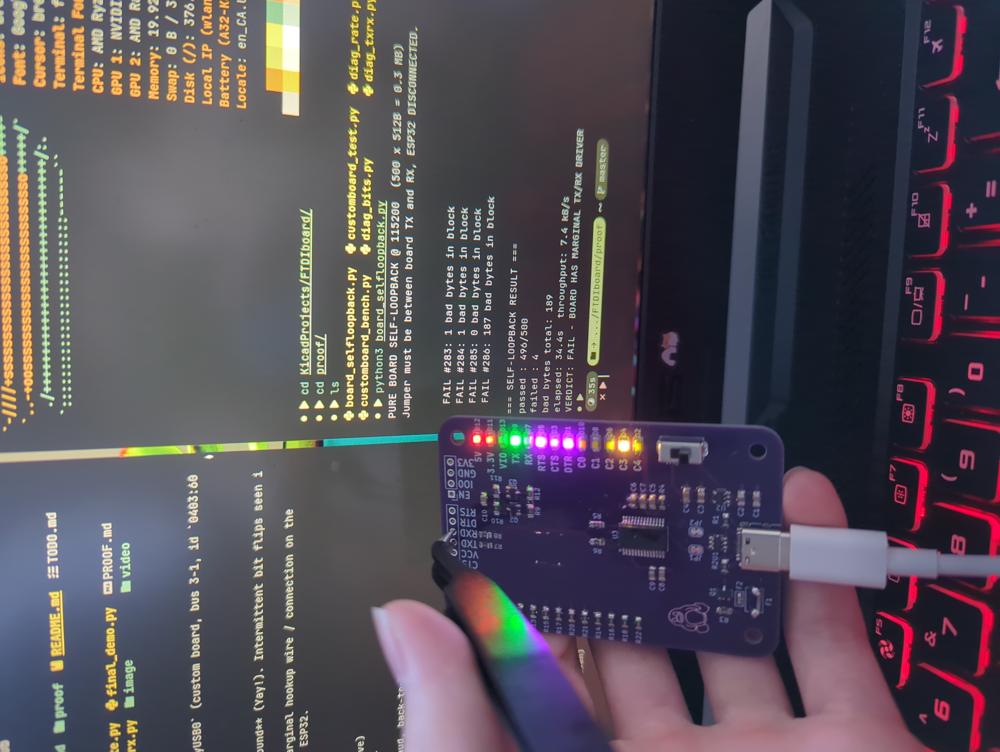
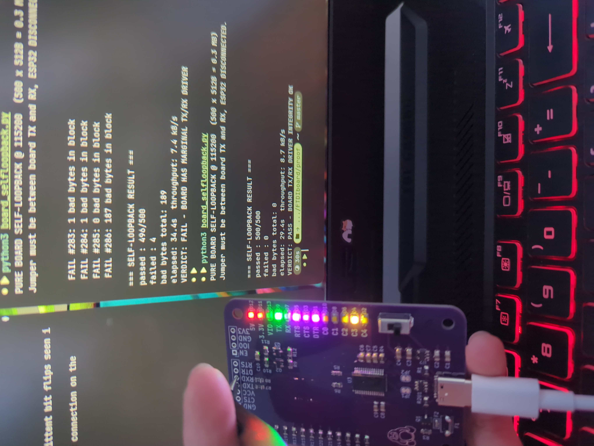

# September 1: v1.1 redesign

## What I did

- Removed ULN2003s
- Added second 2.5a pulyfuse
- added another led
- reassigned designators
- fresh pcb design

## Why

- ULN2003s weren't needed for cbus, FT232 was enough
- 2.5a just in case something goes really wrong
- all cbus pins have leds on them now
- tidied traces from last board more straightforeward layout

## Screenshots

**Total time spent: 4 hours**

# September 3: ordering the v1.1 board

## What I did

- the redesign was done so i hit the buy buttons
- re-exported the fab files (gerbers, drills, pick and place) from the rerouted pcb
- sorted the new lcsc parts list - uln2003s gone, fuse and 13th led in, resistor count dropped from 34 to 25
- uploaded the gerbers to jlcpcb and put in the parts order at the same time so they should land around the same week

## Why

- the aug 22 build taught me the fuse is a pain, so the 2.5a polyfuse placement got a second look before ordering
- wanted the bom to match the redesign exactly - last time stock ran out on the cheap caps mid-order

## Screenshots

**Total time spent: 2 hours**

# September 12: more v1.0 proof while the new boards ship

## What I did

- the v1.1 pcbs were in transit so i went back and hammered the v1.0 board some more
- reran the full proof kit on it again: self-loopback, paced esp32 traffic, and the sustained 512-byte stress case
- grabbed proper go-pro footage of the whole run instead of just screenshots, so the proof is on film
- re-confirmed the vccio bodge and auto-reset latch are both still working as the workarounds, nothing drifted

## Why

- the more runs on v1.0, the better baseline I have to judge v1.1 against when it lands
- the esp32 stress case (512 byte blocks) was the one that bit-flips through the wire, wanted it documented properly on v1.0 before comparing

## Screenshots

[v1.0 proof video](proof/V1/video/compressed/GX011369.mp4)

**Total time spent: 3 hours**

# September 21: v1.1 boards arrived, built

## What I did

- v1.1 pcbs arrived (redesign from september 1 - uln2003s gone, second fuse added, all the fat trimmed)
- assembled the board
- skipped the fuse again, bridged it with tweezers (same as v1.0)
- powered it up

## Why

- wanted to prove the redesign is actually better, not just prettier in the schematic
- leds didnt work on v1

## Screenshots

[bridging the fuse](proof/V1-1/video/VID_20260921_184839.mp4)

once the bridge was in, all the leds lit up and stayed lit - nicest possible first reaction from a board.

**Total time spent: 3 hours**

---

# September 21: v1.1 testing

## What I did

- reran the whole proof kit on the v1.1 board - self-loopback, paced esp32 traffic, sustained-load stress
- confirmed the two v1.0 bugbear fixes hold: auto reset stage no longer latches, vccio rail follows the switch
- recorded the test script running

## Why

- v1.0 testing taught me 512-byte back-to-back blocks are the killer for bit flips through the esp32, so i wouldnt trust v1.1 blind
- wanted on-camera proof instead of "trust me it passed"

## Screenshots

[test script running](proof/V1-1/video/VID_20260921_190001.mp4)

board sat there doing the full self loopback pass clean. the fixes from the redesign actually fixed things and not just the drawing. v1.1 works.

**Total time spent: 3 hours**