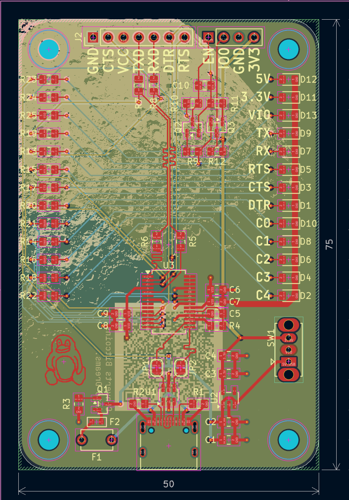
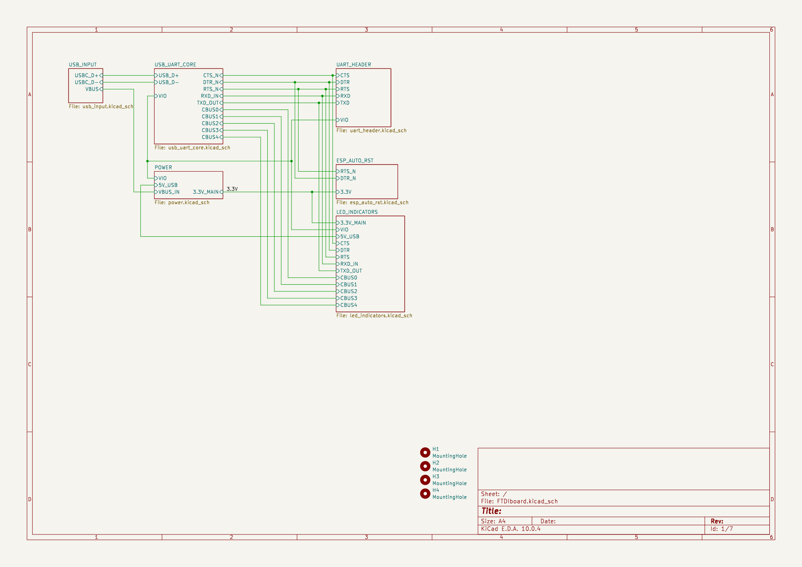
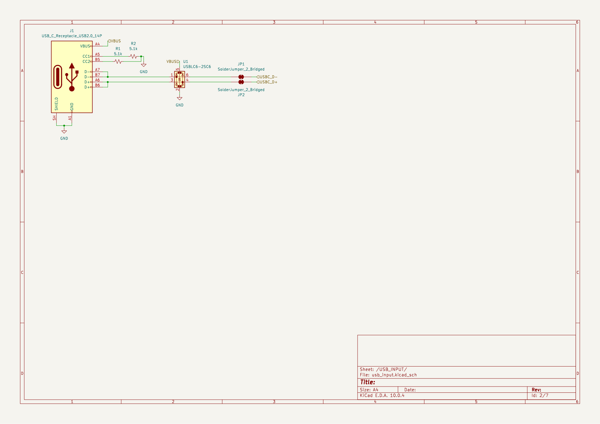
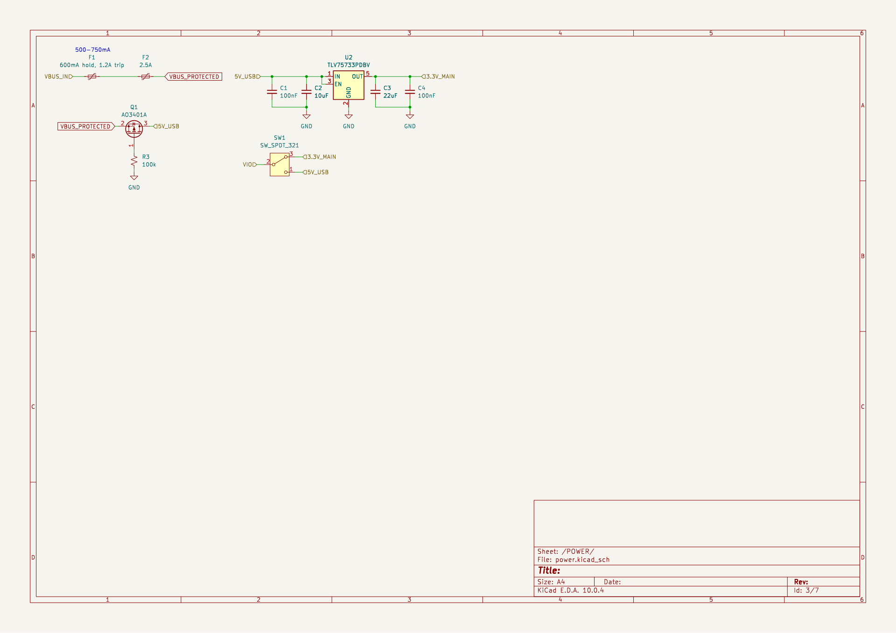
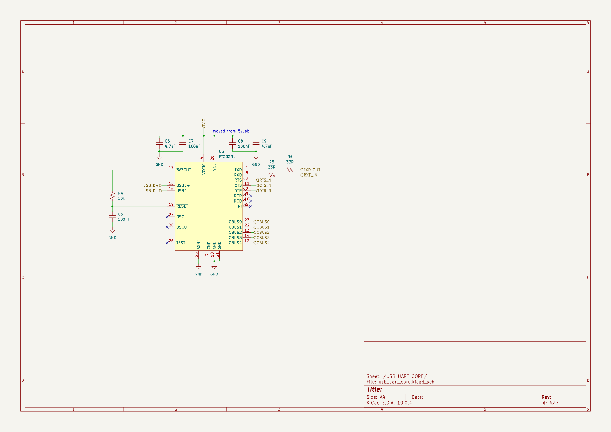
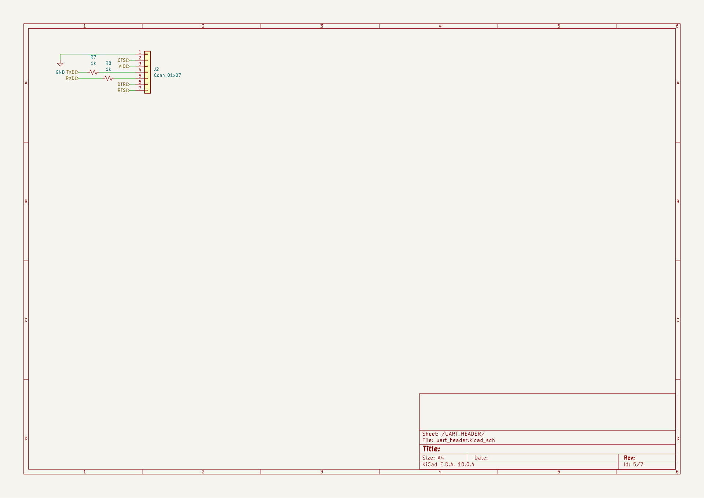
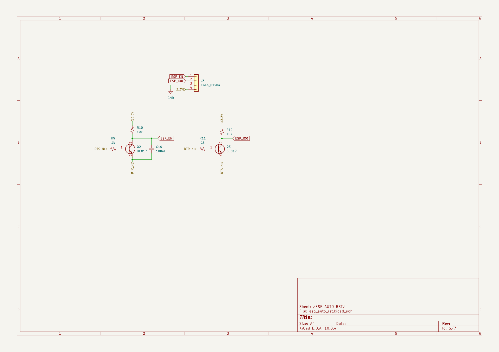
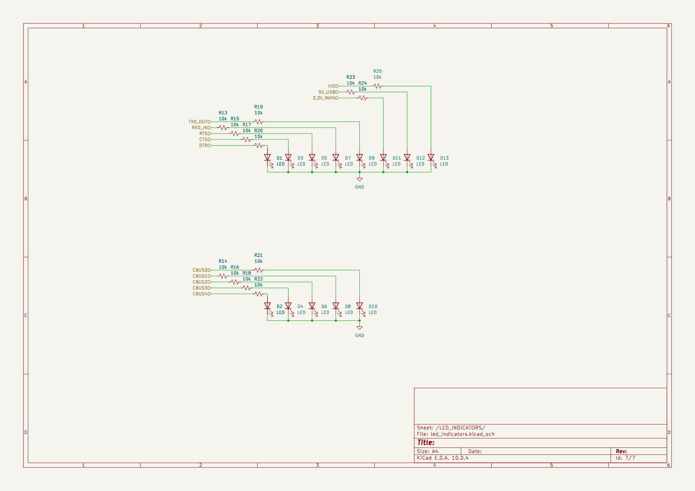
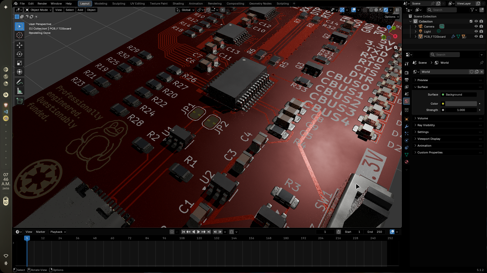
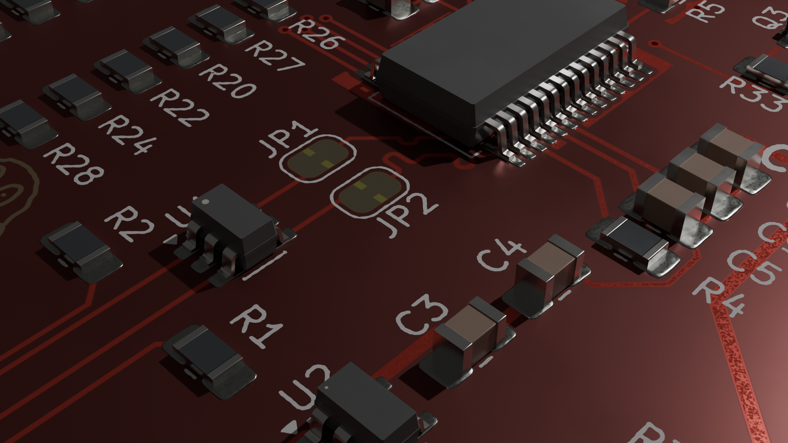

# FTDIboard

FTDIboard is a small USB-to-UART interface that uses the FT232RL and a switchable 3.3V/5V logic rail.

[Finished V1 board](proof/V1/image/IMG_20260908_173817_623.jpg)

## Why I Built This

I wanted a USB-to-UART adapter that I could understand, repair, and use for debugging instead of another closed adapter with no visibility into what it was doing. The shared adapters in the lab were also often broken or already in use, so I built my own with USB protection, selectable logic levels, ESP auto-reset, and LEDs that show what the FT232RL is doing. This v1.1 revision keeps that idea but removes the parts I did not use and fixes the issues found while testing v1.0.

---

## Key Features

- FT232RL USB-to-UART bridge
- Switchable 3.3V / 5V logic levels  
- ESP-style auto-reset
- USB ESD protection
- Resettable Fuse (PPTC): 600mA on VBUS 
- Second resettable fuse: 2.5A polyfuse
- Lots of LEDs
- 75×50mm, 4-layer PCB
- M3 mounting holes
- 2.54mm standard headers

---

## Bill of Materials

| References | Qty | Value | Footprint |
|------------|-----|-------|-----------|
| U3 | 1 | FT232RL | SSOP-28 |
| U2 | 1 | TLV75733PDBV | SOT-23-5 |
| U1 | 1 | USBLC6-2SC6 | SOT-23-6 |
| C1 C4 C5 C7 C8 C10 | 6 | 100nF | 0805 |
| C6 C9 | 2 | 4.7uF | 0805 |
| C2 | 1 | 10uF | 0805 |
| C3 | 1 | 22uF | 0805 |
| R4 R10 R12 R13 R14 R15 R16 R17 R18 R19 R20 R21 R22 R23 R24 R25 | 16 | 10k | 0805 |
| R7 R8 R9 R11 | 4 | 1k | 0805 |
| R3 | 1 | 100k | 0805 |
| R1 R2 | 2 | 5.1k | 0805 |
| R5 R6 | 2 | 33R | 0805 |
| Q2 Q3 | 2 | BC817 | SOT-23 |
| Q1 | 1 | AO3401A | SOT-23 |
| D1 D2 D3 D4 D5 D6 D7 D8 D9 D10 D11 D12 D13 | 13 | LED | 0805 LED |
| J3 | 1 | Conn_01x04 | 1x4 Header 2.54mm |
| J2 | 1 | Conn_01x07 | 1x7 Header 2.54mm |
| J1 | 1 | USB_C_Receptacle_USB2.0_14P | USB-C Receptacle |
| F1 | 1 | 600mA hold, 1.2A trip | Disc 5.1mm |
| F2 | 1 | 2.5A trip | 0603 |
| SW1 | 1 | SW_SPDT_321 | SPDT Slide switch |

*Full BOM available in BOM.csv*

## Fabrication Files

The current **v1.1** manufacturing outputs are included, so you do not need KiCad just to order the board:

- [Ready-to-upload Gerber ZIP](kicad/production/FTDIboard.zip)
- [Individual Gerber and drill files](kicad/production/gerbers/)
- [Native KiCad project](kicad/FTDIboard.kicad_pro)

Order a **75 x 50 mm, 4-layer, 1.6 mm PCB with 1 oz copper**. The package includes all four copper layers, solder mask, silkscreen, paste, board outline, and separate PTH/NPTH Excellon drill files. The `JLCPCB/` and `PCBWAY/` subdirectories contain older v1.0 exports; use the main `FTDIboard.zip` or `gerbers/` directory above for this revision.

## Building and Setting Up the Board

1. **Order the board and parts.** Upload the v1.1 Gerber ZIP to your PCB manufacturer and use [BOM.csv](BOM.csv) for the components and LCSC part numbers. The editable schematic and PCB source are in [`kicad/`](kicad/).
2. **Assemble the board.** Follow the schematic, BOM, and reference designators on the PCB. Check pin 1 on the ICs, transistor orientation, and LED polarity. Install both F1 and F2; do not replace them with solder bridges or wire links.
3. **Check it before applying power.** Inspect for solder bridges, especially around the SSOP-28 FT232RL, and use a multimeter to check for shorts between VBUS and GND and between VIO and GND.
4. **Select the logic voltage.** Set SW1 to 3.3V or 5V before connecting a target. VIO follows this switch on v1.1. Use **3.3V for ESP32/ESP8266 devices**; only use 5V with targets whose UART pins are 5V tolerant.
5. **Connect USB and check the port.** Connect a USB-C cable to the host. Most current Linux, Windows, and macOS systems already support the FT232RL as a virtual COM port. If no serial port appears, install the [FTDI VCP driver](https://ftdichip.com/drivers/vcp-drivers/). On Linux, the board normally appears as `/dev/ttyUSB0` or another `/dev/ttyUSBx` device.
6. **Wire the target.** J2 carries TXD, RXD, DTR, RTS, CTS, VIO, and GND. Connect board TXD to target RXD, board RXD to target TXD, and always connect GND to GND. Connect DTR and RTS as well when using the ESP auto-reset circuit. Use the schematic and board silkscreen to identify the pins.
7. **Test before flashing a project.** Select the new serial port in your terminal or IDE at the target's baud rate. For a basic self-test, disconnect the target, jumper TXD to RXD, disable local echo in the terminal, and confirm that typed characters are returned. The test scripts and recorded results are in [`proof/V1/`](proof/V1/) and [`proof/V1-1/`](proof/V1-1/).

---

## Images

### PCB Layout

### Schematic

### 3D Model

---

## Testing

v1.1 board built and tested, self-loopback passes clean. the two v1.0 bugbear fixes
(auto-reset latch, VCCIO following the switch) are confirmed gone in this revision.

- v1.1 build + test proof: `proof/V1-1/PROOF.md`
- v1.0 electrical soundness proof: `proof/V1/PROOF.md`

---
